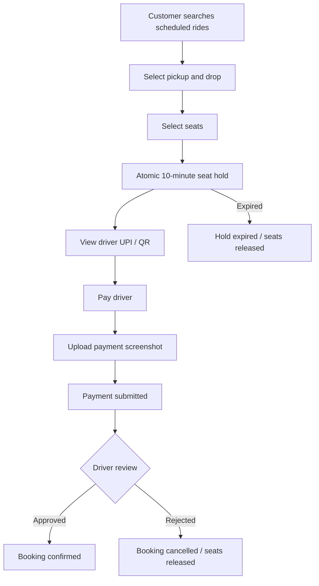
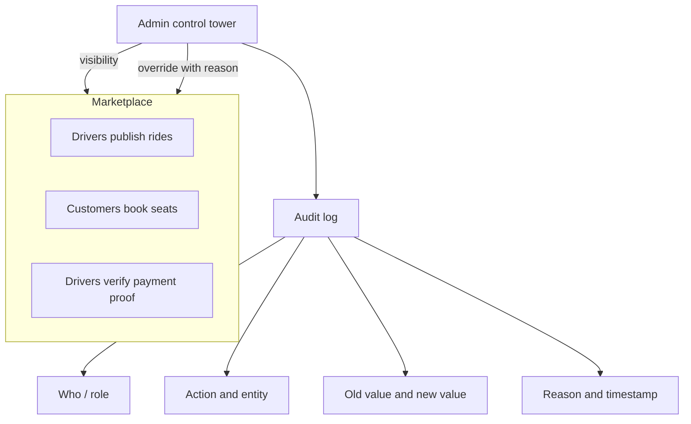
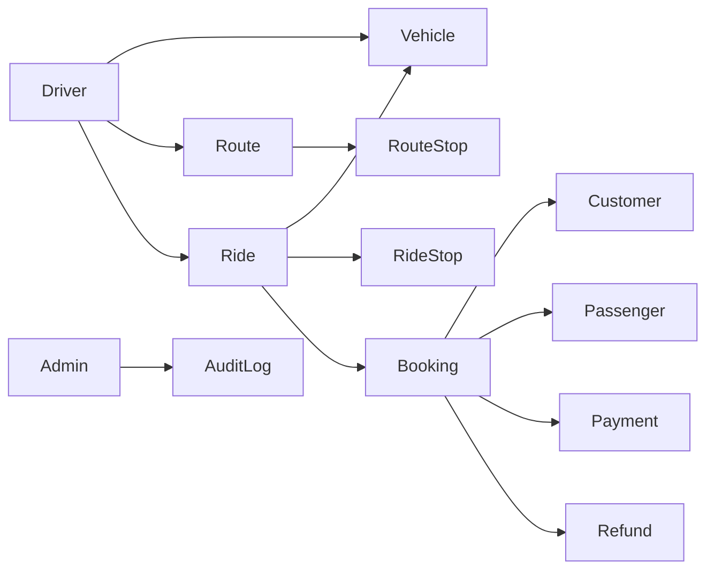

# RaahiX — Scheduled Intercity Shared Rides

RaahiX is a scheduled intercity shared-ride marketplace. Independent drivers publish their own rides. Passengers search those rides and book available seats on a chosen segment.

Shehar Se Shehar, Saath Safar. A product by The Stack Guy.

This is a scheduled seat marketplace. It is not instant taxi hailing, centralized dispatch, peer-to-peer carpooling, or live driver tracking.

**This README is the product and engineering source of truth.** Older notes under `docs/` may still describe an earlier model (admin-published rides and gateway checkout). When those notes disagree with this file, follow this file.

Labels used below:

| Label | Meaning |
| --- | --- |
| **Implemented** | Present in the current repository |
| **Required** | Finalized MVP rule that the product must support; not confirmed in the current code |
| **Planned** | Intentionally out of the initial MVP |

## Overview

```text
ADMIN
  │
  │ complete visibility + emergency/control actions
  │
  ├───────────────┐
  │               │
DRIVER A        DRIVER B
  │               │
  │ creates       │ creates
  │ rides         │ rides
  │               │
  └───────┬───────┘
          │
        RIDES
          │
       CUSTOMERS
          │
       BOOKINGS
```

Drivers are the primary operators of their own rides. Admin is the control tower.

Customers pay the driver directly (UPI / QR) and upload a mandatory payment screenshot. The driver reviews that proof. A booking becomes confirmed only after driver approval. The platform records payment and refund obligations. It does not process card or wallet payments, and it does not pay refunds automatically.

## Product Model

| Actor | Responsibility |
| --- | --- |
| Driver | Registers, gets verified, manages vehicles and payment details, creates routes and rides, reviews payments, runs the trip |
| Customer | Searches scheduled rides, books a valid segment and one or more seats, pays the driver, uploads proof, tracks booking and refund status |
| Admin | Sees the whole marketplace and intervenes when operations require it. Every important override is audited |

The platform does not assign a driver to a passenger request, and it does not operate each booking by hand.

### Current implementation

**Implemented:** a React SPA with Customer, Driver, and Admin areas. Verified drivers create vehicles (maximum 6 seats), routes, and rides. Rides move `DRAFT` → `PUBLISHED` → `ACTIVE` → `COMPLETED`, and `CANCELLED` is terminal. Customers search forward segments, hold seats for 10 minutes, pay the driver directly, and upload a screenshot. Driver approval confirms the booking. Refund obligations and admin overrides are recorded. In-app alerts are stored for the customer and the driver.

**Also still present:** admin can create routes and rides. Legacy ride statuses `SCHEDULED`, `BOARDING`, and `STARTED` remain so older records stay bookable. The gateway routes still exist, and a successful gateway callback does not confirm a booking.

## Core Principles

1. Drivers create and operate their own rides.
2. Admin has full visibility and can override, with an audit record.
3. Customers book seats on a scheduled ride, including a valid intermediate segment.
4. Seat inventory is calculated from overlapping journey segments, not from one ride-wide remaining-seat counter.
5. A seat hold is a 10-minute, concurrency-safe backend reservation.
6. Submitting payment proof does not confirm the booking. Driver approval does.
7. Money moves directly between customer and driver. The platform records verification and refund obligation only.
8. There is no live GPS, no automatic driver assignment, and no online payment gateway in the MVP.

## Initial Operating Scale

| Metric | Initial target |
| --- | --- |
| Drivers | 5–10 |
| Vehicles | Approximately 10–15 |
| Maximum seats per vehicle | 6 |
| Approximate total seats | 60–90 across 10–15 vehicles |
| Expected rides | Approximately 10/day |
| Registered customers | Approximately 200–500 |
| Initial geography / corridor | Richha → Delhi → Noida → Gurugram, plus applicable reverse and segment journeys |

200–500 customers is a registration target. It is not 200–500 simultaneous bookings. Supply is the seats on active rides (about 60–90 seats across the fleet, depending on which vehicles are scheduled). 90 is not a guaranteed daily booking count.

A single Node.js API and MongoDB are sufficient for this scale. Microservices are out of scope.

## User Roles

Roles in code: `CUSTOMER`, `DRIVER`, `ADMIN` (`server/src/constants/enums.js`).

### Customer

Customers can:

- Register and log in
- Search scheduled rides
- Select pickup and drop
- View seats available for that segment
- Book 1–6 seats, or fewer if the segment has less remaining capacity
- Attach multiple passengers to one booking
- View driver, vehicle, pickup, and drop
- Pay the driver using the driver’s UPI / QR details
- Upload a mandatory payment screenshot
- View payment status, booking status, and refund status
- Cancel according to the cancellation policy
- View upcoming, completed, and cancelled bookings
- Contact the driver where supported
- View booking / receipt information

**Implemented screens:** `/`, `/search`, `/rides/:rideId`, `/login`, `/register`, `/register/:role`, `/checkout`, `/booking-success`, `/booking/:bookingId`, `/my-bookings`, `/profile`.

**Implemented booking shape:** one booking stores `passengers[]`, `selectedSeats[]`, `passengerCount`, and `totalAmount`. It is not limited to one passenger. Checkout selects specific seat numbers on a vehicle seat map. Search filters by route origin city, destination city, date, and a passenger count against ride-wide `availableSeats`.

**Required and not implemented:** segment pickup/drop selection, segment-aware availability, direct driver payment, mandatory screenshot upload, and separate Upcoming / Active / Completed / Cancelled lists. My Bookings is currently one combined list.

### Driver

The driver dashboard is an operational console, not an analytics page.

Drivers can:

- Register and complete verification
- Manage profile
- Manage multiple vehicles (add, edit, deactivate)
- Manage payment information: UPI ID, QR code, payment instructions
- Create routes and ordered route stops
- Create rides: choose vehicle, departure date/time, and seat capacity
- View bookings and contact passengers
- Review payment submissions and approve or reject them
- Cancel bookings where the policy allows
- Cancel rides
- Change available capacity only when committed inventory still fits
- Start and complete trips

Example payment instruction shown to the customer: “Pay the exact booking amount and upload the payment screenshot.”

**Implemented screens:** `/driver`, `/driver/rides`, `/driver/rides/:rideId`, `/driver/rides/:rideId/passengers`.

**Implemented API:** dashboard, list rides, ride detail, passenger list, and status updates to `BOARDING`, `STARTED`, or `COMPLETED`. Drivers only see rides already assigned to them.

**Required and not implemented:** driver-owned route/ride/vehicle management, payment-detail management, payment review, booking cancellation by the driver, and ride cancellation by the driver. The status endpoint rejects `CANCELLED` even though the internal transition map allows it from `SCHEDULED` or `BOARDING`. Admin cancels rides today.

Driver registration (`POST /api/auth/register-driver`) creates a user, a driver profile in `PENDING` verification, and one vehicle. Additional vehicles are an admin operation in the current API.

### Admin

Admin is the control tower, with visibility into:

- Drivers and driver verification
- Customers
- Vehicles
- Routes and locations
- Rides
- Bookings
- Payments
- Refunds
- Cancellations
- Reports
- Audit logs
- System settings

Admin can intervene, including:

- Confirm or reject a booking
- Modify payment status
- Cancel a booking or a ride
- Modify seat capacity where the inventory rules allow
- Modify driver or customer records
- Verify or suspend a driver
- Manage vehicles
- Modify routes and locations
- Update refund status
- Resolve operational issues

Every important manual override must be auditable:

```text
WHO
WHAT
ENTITY
OLD VALUE
NEW VALUE
REASON
TIMESTAMP
```

**Implemented screens:** `/admin`, `/admin/users`, `/admin/drivers`, `/admin/vehicles`, `/admin/routes`, `/admin/rides`, `/admin/bookings`, `/admin/payments`, `/admin/reports`, `/admin/audit-logs`.

**Implemented actions:** list and update users; create and update drivers (including verification and status); create and update vehicles; create and update routes; create, update, and cancel rides; list bookings and payments; revenue, booking, and ride reports; list audit logs. Admin booking cancel is `POST /api/bookings/:bookingId/cancel` (admin is authorized on that route). There is no separate “confirm booking” or “set refund status” admin endpoint.

**Required and not implemented:** a dedicated system-settings store, explicit refund-status override, and a required `reason` field on every override. Audit entries today store `actorId`, `actorRole`, `action`, `entityType`, `entityId`, `oldValue`, `newValue`, `metadata`, and `createdAt`. Reason is only present when a caller puts it in `newValue` or `metadata`.

## Driver Verification

Admin controls verification. Only a verified driver may publish rides.

```text
PENDING
   │
   ↓
VERIFIED
   │
   ├────→ SUSPENDED
   │
   └────→ REJECTED
```

`SUSPENDED` is an operational status. In the current schema it is `Driver.status` (`ACTIVE`, `INACTIVE`, `SUSPENDED`), while verification is `Driver.verificationStatus` (`PENDING`, `VERIFIED`, `REJECTED`).

**Implemented:** both fields exist. Admin can change them with `PATCH /api/admin/drivers/:id`. New self-registered drivers start as `PENDING`. Ride assignment requires `Driver.status === ACTIVE` and an active vehicle. It does **not** require `verificationStatus === VERIFIED`.

**Required:** block ride publication unless the driver is verified. On suspension:

- The driver cannot publish new rides.
- Existing booking history is preserved.
- Future rides need explicit operational handling.
- Do not automatically mass-cancel rides. The current code does not mass-cancel on suspension; keep that behavior.

The driver profile stores `licenseNumber`. Do not add further KYC document types unless they are introduced deliberately. There is no document-upload implementation.

## Vehicle Management

A driver may own multiple vehicles. A vehicle is its own record, not a field on the driver.

```text
Driver
 ├── Vehicle A
 ├── Vehicle B
 ├── Vehicle C
 └── Vehicle D
```

**Implemented fields** (`Vehicle`):

| Field | Notes |
| --- | --- |
| `driverId` | Reference to `Driver` |
| `registrationNumber` | Unique, stored uppercase |
| `make`, `model` | Required |
| `vehicleType` | Current layouts: `5_SEATER`, `7_SEATER` |
| `capacity` | Must equal `seatConfiguration.length` |
| `seatConfiguration[]` | `seatNumber`, `row`, `position` |
| `features[]` | Optional strings |
| `status` | `ACTIVE`, `INACTIVE`, `MAINTENANCE` |

**Domain fields not in the model:** `color`, `documents`.

**Required capacity rule:**

```text
ride.capacity <= vehicle.seatCapacity
```

The initial product maximum is **6 seats per vehicle**. Current seed layouts include a 7-seater. That exceeds the product maximum and should not be treated as the target fleet rule.

A driver must not reduce a ride’s capacity below seats already committed on any affected segment.

```text
Vehicle capacity = 6
Committed seats  = 5

Changing ride capacity to 4
→ MUST BE REJECTED
```

**Implemented:** changing the vehicle on a ride is rejected while `PENDING` or `CONFIRMED` bookings exist. There is no ride-capacity override that checks committed seats, because capacity is copied from the vehicle seat map.

**Vehicle deactivation:** do not delete a vehicle that has current or future rides. Prefer `INACTIVE` or `MAINTENANCE`. Historical bookings must keep their vehicle context. The API updates vehicle status; it does not hard-delete vehicles.

## Route & Location System

Drivers may create routes. Routes are not limited to an admin master list.

```text
Richha → Delhi → Noida → Gurugram
Delhi → Noida → Gurugram
Richha → Delhi
```

The same physical place must not accumulate as unrelated spellings. Location normalization is a directory of places, not a map-routing or GIS product.

Conceptual location:

```text
Location
 ├── name
 ├── normalizedName
 ├── city
 ├── state
 ├── aliases
 └── optional geo information
```

**Implemented:** `Route` has `origin` (`city`, `state`), `destination` (`city`, `state`), `stops[]` (`name`, `city`, `state`, `sequence`), `estimatedDuration` (minutes), and `status` (`ACTIVE`, `INACTIVE`). There is no `Location` collection, no `normalizedName`, and no aliases. Search matches the route’s origin city and destination city exactly (case-insensitive). Intermediate stops are not bookable segments. Only admin can create or update routes.

**Required:** driver-created routes, shared normalized locations, and segment search across ordered stops.

## Multi-Stop Rides

A ride follows an ordered stop list.

```text
Stop 1: Richha
Stop 2: Delhi
Stop 3: Noida
Stop 4: Gurugram
```

Each stop conceptually has:

- Location
- Sequence
- Whether pickup is allowed
- Whether drop is allowed
- Optional estimated time

**Implemented:** route-level stops with name, city, state, and sequence, plus a single `estimatedDuration` for the whole route. A ride stores one `pickupPoint` and one `dropPoint` string, plus `departureTime` and `arrivalTime`. There is no per-stop pickup/drop flag and no per-stop ETA. Do not invent stop-time calculations.

**Required:** ride stops that mirror the route order and support segment booking.

## Segment-Based Seat Inventory

Customers may book any valid forward segment. They are not limited to the full route.

For Richha → Delhi → Noida → Gurugram, valid journeys are:

```text
Richha → Delhi
Richha → Noida
Richha → Gurugram
Delhi → Noida
Delhi → Gurugram
Noida → Gurugram
```

Invalid journeys:

- Pickup equals drop
- Drop occurs before pickup in the stop order (example: Noida → Delhi)

### Inventory rule

Do not use a single ride-wide `availableSeats` value as the source of inventory. Availability is the capacity minus seats already held or confirmed on **overlapping** segments.

Vehicle capacity: 6.

| Booking | Journey | Seats |
| --- | --- | --- |
| A | Richha → Delhi | 2 |
| B | Delhi → Gurugram | 2 |

Resulting availability:

```text
Richha → Delhi     4 available
Delhi → Noida      2 available
Noida → Gurugram   4 available
```

A Richha → Noida booking occupies Richha → Delhi and Delhi → Noida. It does not occupy Noida → Gurugram.

**Implemented today:** each ride copies the vehicle seat map. Each seat is `AVAILABLE`, `HELD`, `BOOKED`, or `BLOCKED`. `availableSeats` is the count of `AVAILABLE` seats on that ride. A hold locks named seats for the whole ride. Two passengers cannot share a seat even when their journeys do not overlap. Search uses `availableSeats >= passengers` on origin-to-destination routes only.

That ride-wide seat map is the current mechanism. It is not the finalized inventory rule.

## Booking Flow



One booking can cover multiple seats and multiple passengers:

```text
Booking
 ├── customer
 ├── passengers[]
 ├── seatCount
 ├── pickup
 ├── drop
 ├── amount
 ├── payment
 └── status
```

**Implemented flow:** search → ride detail seat map → `POST /api/bookings/hold` → `POST /api/bookings` with passenger details per selected seat → gateway order and verify. Pickup and drop are the ride’s single pickup and drop strings, not a chosen segment.

## Booking State Machine

Target lifecycle:

```text
                ┌───────────┐
                │   HELD    │
                └─────┬─────┘
                      │
             payment submitted
                      ↓
           ┌────────────────────┐
           │ PAYMENT_SUBMITTED  │
           └─────────┬──────────┘
                     │
             ┌───────┴────────┐
             ↓                ↓
         APPROVED           REJECTED
             ↓                ↓
        CONFIRMED          CANCELLED
             │
        ┌────┴─────┐
        ↓          ↓
    COMPLETED   CANCELLED

HELD
 ↓
EXPIRED
```

Payment submission does not confirm the booking. Only driver approval creates `CONFIRMED`.

**Implemented statuses:** `PENDING`, `CONFIRMED`, `CANCELLED`, `EXPIRED`.

| Target state | Current code |
| --- | --- |
| `HELD` | `PENDING` while `holdExpiresAt` is in the future and payment is not completed |
| `PAYMENT_SUBMITTED` | Not a status. Gateway `PENDING` / `CREATED` is an order, not proof review |
| `APPROVED` → `CONFIRMED` | Gateway verify or webhook sets `CONFIRMED` immediately. No driver approval |
| `REJECTED` → `CANCELLED` | Gateway failure sets payment `FAILED` and leaves the booking `PENDING` until hold expiry |
| `COMPLETED` | Not a booking status. Ride `COMPLETED` is separate |
| `EXPIRED` | Hold job sets `EXPIRED` and releases the hold |

## Seat Hold & Concurrency

```text
Customer selects ride
       ↓
Select pickup/drop
       ↓
Select seats
       ↓
10-minute atomic hold
```

The hold carries `holdExpiresAt`. On expiry:

```text
HELD → EXPIRED → inventory released
```

The hold must be concurrency-safe and atomic. A frontend availability check is not sufficient.

Scenario:

```text
6 seats available on the affected segment

Customer A requests 4
Customer B requests 4
```

Both requests must not consume the same inventory. The backend enforces this in one atomic update.

Invariant, for every affected journey segment:

```text
active HELD seats
+ CONFIRMED seats
+ other committed inventory
≤ vehicle capacity
```

**Implemented:** `HOLD_DURATION_MINUTES` defaults to 10. Segment holds use one atomic update so two requests cannot both take the last seats on an overlapping leg. Named-seat holds remain for rides that have no stops. A background job runs about every 60 seconds and releases expired holds. Driver approval after `holdExpiresAt` does not confirm the booking.

### Payment submitted after the hold expires

```text
14:00  Booking held
14:09  Screenshot submitted
14:10  Hold expires
14:12  Driver reviews payment
```

The platform must not automatically turn that expired booking into a confirmed booking. A payment submission does not keep the seats after `holdExpiresAt`. Any later resolution is an explicit driver or admin action, and it must re-check segment capacity before committing seats.

## Payment Verification

There is no online payment gateway in the MVP. The customer pays the driver directly.

```text
Customer
   ↓
Booking hold
   ↓
Driver UPI / QR details
   ↓
Customer pays driver
   ↓
Mandatory screenshot upload
   ↓
Payment submitted
   ↓
Driver reviews
   ↓
Approve / Reject
```

Driver payment details:

```text
UPI ID
QR Code
Payment Instructions
```

This is payment recording and verification, not payment processing.

Payment states:

```text
NOT_SUBMITTED
     ↓
SUBMITTED
     ↓
APPROVED
     │
     └──→ CONFIRMED BOOKING

SUBMITTED
     ↓
REJECTED
```

The screenshot is mandatory. The customer cannot submit payment for review without it. The platform must be able to determine:

- Who submitted the proof
- Which booking it belongs to
- When it was submitted
- Amount
- Screenshot
- Verification status
- Who approved or rejected it
- When it was reviewed
- Rejection reason, when rejected

**Implemented:** driver `upiId`, `qrCode`, and `paymentInstructions`. `POST /api/bookings/:bookingId/payment-proof` requires a PNG, JPEG, or WebP screenshot of at most 2 MB and sets proof `SUBMITTED` without confirming the booking. `POST /api/driver/bookings/:bookingId/review` with `APPROVE` confirms the booking only while the hold is still open. `REJECT` cancels it and releases the seats. A review after `holdExpiresAt` returns `409` and does not confirm. `GET /api/bookings/:bookingId/proof` is limited to the customer, that ride’s driver, and admin. Admin `POST /api/admin/bookings/:id/resolve` can confirm later, and it re-checks segment capacity. Gateway verify and webhook still record a gateway payment, and they do not set the booking to `CONFIRMED`.

### What the repository does today

`razorpay` is a server dependency. `PAYMENT_GATEWAY` defaults to Razorpay, and tests/local dev can use a mock gateway (`server/src/services/payment/gateway.js`).

Implemented payment routes:

| Method | Path | Auth |
| --- | --- | --- |
| `POST` | `/api/payments/create-order` | Customer |
| `POST` | `/api/payments/verify` | Customer |
| `POST` | `/api/payments/webhook` | Gateway signature, no user JWT |

A successful verify or webhook sets payment `SUCCESS` and booking `CONFIRMED` inside `confirmPaymentSuccess`. That behavior contradicts the finalized rule that driver approval is required. Treat the gateway adapter as existing code, not as the MVP payment design. Do not add Razorpay, Stripe, PayU, Cashfree, or another gateway as the product path.

Implemented payment fields: `bookingId`, `userId`, `amount`, `currency` (default `INR`), `gateway`, `gatewayOrderId`, `gatewayPaymentId`, `gatewaySignature`, `status` (`CREATED`, `PENDING`, `SUCCESS`, `FAILED`, `REFUNDED`), `paidAt`, `refundAmount`, `refundedAt`, `rawResponse`.

Booking payment status in code: `PENDING`, `PAID`, `FAILED`, `REFUNDED`.

## Cancellation & Refund Policy

Launch policy:

| Cancellation timing | Refund obligation |
| --- | ---: |
| More than 24 hours before departure | 100% |
| 6–24 hours before departure | 50% |
| Less than 6 hours before departure | 0% |
| After the trip starts | 0% |
| Driver cancels the ride | 100% |
| Admin cancels the ride | 100% |

The customer pays the driver directly, so the platform records the refund obligation and status. The driver sends the money back manually. Admin can update or override refund status. The platform does not transfer refunds.

Conceptual refund fields (not a separate collection today):

```text
refundAmount
refundStatus
refundProcessedAt
refundProcessedBy
refundReference
```

Refund states:

```text
NOT_APPLICABLE
PENDING
PARTIAL
COMPLETED
WAIVED
```

**Implemented:** customer cancellation records `refundAmount` and `refundStatus` from the timing table: more than 24 hours is 100%, 6–24 hours is 50%, and less than 6 hours is 0% (`NOT_APPLICABLE`). No payout is created. Admin `PATCH /api/admin/bookings/:id/refund` updates `refundStatus`, `refundReference`, `refundProcessedAt`, and `refundProcessedBy`, and it requires a reason. Driver or admin ride cancellation keeps the booking documents and records a 100% obligation on confirmed bookings.

### Ride cancellation

If a driver or admin cancels a ride, the ride becomes `CANCELLED`. Confirmed bookings on that ride are cancelled with a **100%** refund obligation. The driver still handles the actual refund. Customers should be notified that the booking was cancelled.

**Implemented:** admin cancellation and driver `CANCELLED` both cancel affected bookings, keep the records, and record a 100% refund obligation for confirmed bookings.

## Ride Lifecycle

Target lifecycle:

```text
DRAFT
  ↓
PUBLISHED
  ↓
ACTIVE
  ↓
COMPLETED
```

Cancellation is terminal:

```text
DRAFT / PUBLISHED / ACTIVE
          ↓
       CANCELLED
```

Do not allow `COMPLETED → PUBLISHED` or `CANCELLED → ACTIVE`.

**Implemented driver transitions:** `DRAFT` → `PUBLISHED` → `ACTIVE` → `COMPLETED`, plus `CANCELLED` from the open states. `COMPLETED` → `PUBLISHED` and `CANCELLED` → `ACTIVE` are rejected. Legacy `SCHEDULED`, `BOARDING`, and `STARTED` transitions remain. A new driver ride starts as `DRAFT`. Only a verified active driver can publish. Capacity cannot drop below seats already committed on a named seat or a segment leg.

Driver trip operations the dashboard should center on:

```text
Create ride
Edit ride
Cancel ride
View passengers
View payments
Change seats where allowed
Start trip
Complete trip
Contact passengers
```

**Implemented:** driver screens for vehicles, routes, payment details, payment review, rides, and trip status. Customer screens cover segment search, checkout with a screenshot upload, booking detail, and My Bookings split into Upcoming, Active, Completed, and Cancelled.

## Notifications

Keep this small. Persist a notification and send it. Do not build an event bus.

### Customer

- Booking created
- Payment submitted
- Payment approved
- Payment rejected
- Booking confirmed
- Booking cancelled
- Ride cancelled
- Refund status updated

### Driver

- New booking
- Payment submitted
- Booking cancellation
- Upcoming ride
- Ride cancellation

Channels for MVP:

- Email
- In-app notification
- WhatsApp / deep link where supported

**Implemented:** the same notification record, plus channel `IN_APP` and a `read` flag. `GET /api/notifications` and `PATCH /api/notifications/:id/read` serve the signed-in user. Creating a booking, submitting proof, approving, rejecting, cancelling a booking, cancelling a ride, updating a refund, and publishing a ride each write an in-app record for the customer or driver named in the lists above. Email is attempted on the same events. A failed email is stored as `FAILED` and does not undo the booking or payment decision. WhatsApp is still a `wa.me` link, not the WhatsApp Business API.

## Admin Control & Audit Logs



Audit concept:

```text
AuditLog
 ├── actor
 ├── actorRole
 ├── action
 ├── entityType
 ├── entityId
 ├── oldValue
 ├── newValue
 ├── reason
 └── timestamp
```

At minimum, audit:

- Booking status changes
- Payment status changes
- Refund changes
- Ride cancellation
- Capacity overrides
- Driver verification
- Driver suspension
- Important customer or driver modifications

**Implemented:** `AuditLog.reason`. Admin changes to a user, driver, ride, booking cancellation, refund status, and a late payment resolution require a reason. The stored entry has the actor, role, action, entity, old value, new value, reason, and timestamp. An override without a reason is rejected.

## Business Invariants

1. Only verified drivers can publish rides.
2. A ride must use a valid vehicle.
3. Ride capacity cannot exceed vehicle capacity.
4. Pickup must occur before drop in the ride stop sequence.
5. Customers can book multiple seats.
6. Booking inventory is segment-aware.
7. Active holds and confirmed bookings cannot exceed segment capacity.
8. Holds expire after 10 minutes.
9. Expired holds release inventory.
10. Payment submission does not equal booking confirmation.
11. Driver approval is required for confirmation.
12. Driver cancellation triggers a 100% refund obligation.
13. Admin cancellation triggers a 100% refund obligation.
14. Customer cancellation follows the time-based refund policy.
15. Important admin overrides are audited.
16. Historical booking information must remain consistent.

Invariants 5, 8, and parts of 9, 15, and 16 exist in the current code in a narrower form (named seats, admin audit on some mutations, vehicle change blocked when bookings exist). Invariants 1, 3 as a capacity check, 4, 6, 7, 10, 11, 12, and 14 are **required** and not enforced as specified. Invariant 13 is only partially implemented: admin ride cancel flags a full refund status, without the refund-obligation model.

## Core Data Model

Target entities:

```text
User
DriverProfile
CustomerProfile

Vehicle

Location
Route
RouteStop

Ride
RideStop

Booking
BookingPassenger

Payment
Refund

Notification

AuditLog
SystemSetting
```

Relationships:

```text
Driver
 ├── Vehicles
 ├── Routes
 └── Rides

Route
 └── RouteStops

Ride
 ├── Vehicle
 ├── RideStops
 └── Bookings

Booking
 ├── Customer
 ├── Passengers
 ├── Pickup
 ├── Drop
 ├── Payment
 └── Refund
```



**Implemented collections:** `User`, `Driver`, `Vehicle`, `Route` (stops embedded), `Ride` (seats embedded), `Booking` (passengers embedded), `Payment`, `Notification`, `AuditLog`.

There is no `CustomerProfile` (customer data is `User`), no `Location`, no `RideStop`, no `Refund` collection, and no `SystemSetting`. Passengers are subdocuments, not their own collection. Do not split these into dozens of collections for documentation’s sake.

## System Architecture

```text
React (Vite) → REST /api → Express services → Mongoose → MongoDB
```

| Layer | Present in the repository |
| --- | --- |
| Frontend | React 19, Vite, Tailwind CSS, React Router, TanStack Query, Axios, Framer Motion, Lucide |
| Backend | Node.js, Express, Mongoose, JWT (`jsonwebtoken`), bcrypt (`bcryptjs`), Zod, Helmet, CORS, Morgan |
| Database | MongoDB. Optional `mongodb-memory-server` when `USE_MEMORY_MONGO=true` |
| Validation | Zod on auth and main write/search payloads |
| Email | Nodemailer, console transport by default |
| Jobs | In-process `setInterval` hold expiry (about every 60s) |
| Tests | Jest, Supertest, mongodb-memory-server |

Not in the repository, and not part of the MVP architecture: Redis, Socket.IO, Cloudinary, S3, Docker, a message bus, or a microservice split.

`razorpay` is installed and wrapped by `server/src/services/payment/gateway.js`. That adapter is current code. The finalized payment architecture is direct driver transfer plus proof review, described under Payment Verification.

## API Architecture

Base path: `/api`. Health: `GET /api/health`.

Success responses use `{ success, message, data }`. Errors use the shared error handler (`server/src/middleware/errorHandler.js`).

### Authentication — implemented

| Method | Path | Access |
| --- | --- | --- |
| `POST` | `/api/auth/register` | Public, rate limited |
| `POST` | `/api/auth/register-driver` | Public, rate limited |
| `POST` | `/api/auth/login` | Public, rate limited |
| `POST` | `/api/auth/refresh` | Public, rate limited |
| `POST` | `/api/auth/logout` | Authenticated |
| `GET` | `/api/auth/me` | Authenticated |
| `PATCH` | `/api/auth/me` | Authenticated |

Access tokens are sent as `Authorization: Bearer`. Refresh tokens are stored hashed on the user.

### Customers — implemented

| Method | Path | Access |
| --- | --- | --- |
| `GET` | `/api/rides/search` | Public. Query: `originCity`, `destinationCity`, `date`, optional `passengers` |
| `GET` | `/api/rides/:rideId` | Public |
| `GET` | `/api/rides/:rideId/seats` | Public |
| `POST` | `/api/bookings/hold` | Customer |
| `POST` | `/api/bookings` | Customer |
| `GET` | `/api/bookings` | Customer. Aliases: `/my`, `/mine` |
| `GET` | `/api/bookings/:bookingId` | Customer owner or Admin |
| `POST` | `/api/bookings/:bookingId/cancel` | Customer owner or Admin |

### Drivers — implemented

All routes require a driver JWT.

| Method | Path |
| --- | --- |
| `GET` | `/api/driver/dashboard` |
| `GET` | `/api/driver/rides` |
| `GET` | `/api/driver/rides/:rideId` |
| `GET` | `/api/driver/rides/:rideId/passengers` |
| `PATCH` | `/api/driver/rides/:rideId/status` |

### Vehicles, routes, rides — implemented as admin operations

| Method | Path |
| --- | --- |
| `GET`, `POST` | `/api/admin/vehicles` |
| `GET`, `PATCH` | `/api/admin/vehicles/:id` |
| `GET`, `POST` | `/api/admin/routes` |
| `PATCH` | `/api/admin/routes/:id` |
| `GET`, `POST` | `/api/admin/rides` |
| `GET`, `PATCH` | `/api/admin/rides/:id` |
| `DELETE` | `/api/admin/rides/:id` |

### Payments — implemented gateway routes

See Payment Verification. These routes are the current gateway flow, not the required proof-review flow.

| Method | Path | Access |
| --- | --- | --- |
| `POST` | `/api/payments/create-order` | Customer, rate limited |
| `POST` | `/api/payments/verify` | Customer, rate limited |
| `POST` | `/api/payments/webhook` | Signature check |

### Admin — implemented

| Method | Path |
| --- | --- |
| `GET` | `/api/admin/dashboard` |
| `GET` | `/api/admin/users` |
| `GET` | `/api/admin/users/:id` |
| `PATCH` | `/api/admin/users/:id/status` |
| `GET`, `POST` | `/api/admin/drivers` |
| `GET`, `PATCH` | `/api/admin/drivers/:id` |
| `GET` | `/api/admin/bookings` |
| `GET` | `/api/admin/bookings/:id` |
| `GET` | `/api/admin/payments` |
| `GET` | `/api/admin/payments/:id` |
| `GET` | `/api/admin/reports/revenue` |
| `GET` | `/api/admin/reports/bookings` |
| `GET` | `/api/admin/reports/rides` |
| `GET` | `/api/admin/audit-logs` |

There is no refunds router and no notifications router.

### Planned API

No paths below exist. Names are capabilities, not endpoints to call.

| Area | Required capability |
| --- | --- |
| Drivers | Create and edit own routes, rides, and vehicles. Deactivate a vehicle. Set UPI ID, QR, and payment instructions |
| Rides | Publish, edit, cancel, start, and complete own rides. Change capacity only when committed segment inventory still fits |
| Bookings | Segment search and segment hold. Driver lists bookings, approves or rejects payment, cancels where policy allows |
| Payments | Submit mandatory screenshot. Record reviewer, review time, and rejection reason. Do not confirm on upload |
| Refunds | Compute the policy obligation. Admin override of refund status. No automatic payout |
| Notifications | Driver events and the customer events listed above that are not already emailed |
| Admin | Audited overrides for booking confirmation, payment status, capacity, and refund status, each with a reason |

## Project Structure

```text
├── client/                         # React SPA
│   ├── index.html
│   ├── vite.config.js              # Dev server :5173, proxies /api → :5055
│   ├── .env.example
│   └── src/
│       ├── main.jsx
│       ├── App.jsx                 # Route table
│       ├── index.css
│       ├── context/                # Auth state
│       ├── routes/                 # ProtectedRoute, RoleRoute
│       ├── pages/
│       │   ├── public/             # Home, search, ride detail, login, register
│       │   ├── customer/           # Checkout, bookings, profile
│       │   ├── driver/             # Dashboard, rides, passengers
│       │   └── admin/              # Ops console
│       ├── components/             # Layout, booking, rides, seats, ui
│       ├── services/               # Axios API clients
│       ├── hooks/
│       └── utils/
├── server/                         # Express API
│   ├── .env.example
│   └── src/
│       ├── server.js               # Listen, optional seed, hold-expiry job
│       ├── app.js                  # Helmet, CORS, JSON, /api
│       ├── config/
│       ├── constants/              # Roles and status enums
│       ├── models/
│       ├── routes/
│       ├── controllers/
│       ├── services/               # Booking, seats, rides, payments, admin
│       ├── validators/             # Zod
│       ├── middleware/             # Auth, errors, rate limits
│       ├── jobs/expireHolds.js
│       ├── scripts/                # seed.js, runSeed.js
│       └── utils/
├── server/tests/                   # Jest + Supertest
├── docs/                           # Earlier design notes; this README wins on product rules
├── package.json                    # Root scripts
└── README.md
```

`scripts/` is referenced by older notes but is not a root package in this repository. Seed lives in `server/src/scripts/`.

## Security

| Control | Status |
| --- | --- |
| Password hashing (bcrypt) and JWT access + refresh | Implemented |
| Role checks (`authorize`) on customer, driver, and admin routers | Implemented |
| Booking read/cancel limited to the owner or an admin | Implemented |
| Payment order/verify limited to the booking’s customer | Implemented |
| Driver ride/passenger reads limited to that driver’s rides | Implemented |
| Zod validation on auth, search, hold, booking, and admin writes | Implemented |
| Helmet and CORS (`CLIENT_URL`, plus local Vite origins outside production) | Implemented |
| Rate limits: auth 50 / 15 min, payment 30 / 15 min | Implemented |
| Webhook signature check on the gateway route | Implemented for the current gateway adapter |
| Secrets via `server/.env` (not committed; see `.gitignore`) | Implemented as a practice. `.env.example` ships placeholders only |
| Audit log for listed admin mutations | Implemented, partial versus the required audit list |
| Unverified driver cannot publish | Implemented. `DRIVER_NOT_VERIFIED` |
| Segment capacity enforced on the server | Implemented. Overlapping legs are updated atomically |
| Payment proof access control | Implemented. The screenshot file is served only to the customer, that ride’s driver, and admin |
| File type/size checks for screenshots | Implemented. PNG, JPEG, or WebP, at most 2 MB. Driver documents beyond `licenseNumber` are not collected |
| Customer cannot change another customer’s booking; driver cannot review another driver’s payment | Implemented |

Do not put payment screenshots or driver documents on uncontrolled public URLs. The repository has no upload pipeline yet. When proof storage is added, serve files only to the booking customer, the ride’s driver, and admin.

Blocked and inactive users fail authentication (`USER_BLOCKED`).

## Edge Cases

### Booking concurrency

- Two customers request the last seats at the same time. The backend must accept only the request that still fits.
- Overlapping segment bookings must reduce only the segments they occupy.
- The hold expires while the customer is paying. Seats return to inventory.
- Payment proof arrives after `holdExpiresAt`. Do not auto-confirm.
- A request for more seats than the segment has left is rejected.

**Current code:** concurrent holds of the same named seat fail. Overlapping-segment cases are not modeled. Gateway confirmation can still succeed if the booking is `PENDING` after the timestamp has passed but before the expiry job runs.

### Payment

- Wrong amount
- Invalid screenshot
- Duplicate screenshot
- Rejected payment
- Payment approved after the booking was already cancelled
- Refund still pending with the driver

**Current code:** bad gateway signatures mark payment `FAILED`. Repeat verify of a `SUCCESS` payment is idempotent. Screenshot rules do not exist. Approving a payment after cancel is not a driver action; `confirmPaymentSuccess` rejects bookings already `CANCELLED` or `EXPIRED`.

### Ride

- Driver cancels the ride → affected confirmed bookings cancelled, 100% refund obligation
- Admin cancels the ride → same obligation
- Trip starts while some payments are still unreviewed
- Ride details change after bookings exist
- Capacity cannot drop below committed seats

**Current code:** only admin cancel is implemented, and it flags a full refund status rather than an obligation workflow. Vehicle swap is blocked when active bookings exist. Other post-booking edits (pickup text, price, times) are still allowed for admin.

### Vehicle

- Deactivate instead of deleting when rides exist
- Future rides stay attached to a coherent vehicle record
- Capacity changes must respect committed seats
- A driver attempt to delete a vehicle is refused or converted into deactivation

**Current code:** no vehicle delete route. Status can be set to `INACTIVE` or `MAINTENANCE`. Historical rides keep `vehicleId`.

### Driver

- Suspended driver cannot publish new rides
- Rejected driver cannot publish
- Lost access does not erase history
- Existing rides stay until an operator handles them

**Current code:** suspension does not mass-cancel. New ride creation does not check verification or suspension beyond `status === ACTIVE` at admin assignment time.

### Route

- Duplicate stop
- Pickup equals drop
- Drop before pickup
- Invalid segment
- Route edited after bookings exist

**Current code:** search requires the route origin city and destination city. It does not validate a passenger segment against stop order.

## Testing Strategy

Segment inventory and concurrent booking are the highest-risk areas. Test those before treating a release as safe.

### Inventory

```text
segment capacity
overlapping bookings
concurrent booking
hold expiry
inventory release
```

### Booking

```text
1 seat
multiple seats
multiple passengers
valid segments
invalid segments
```

### Payment

```text
submission
approval
rejection
expiry
refund status
```

Include the 14:00 / 14:10 expiry case: proof after hold expiry must not confirm the booking by itself.

### Authorization

```text
customer cannot manage another customer's booking
driver cannot manage another driver's ride
driver cannot modify an unrelated payment
unverified driver cannot publish
admin override works and writes an audit record
```

### Ride lifecycle

```text
draft
publish
start
complete
cancel
```

Reject `COMPLETED → PUBLISHED` and `CANCELLED → ACTIVE`.

**Implemented tests** (`npm test`, `server/tests/critical.test.js`): register/login, invalid password, missing token, customer blocked from admin, ride search, seat concurrency, booking and gateway payment idempotency, and driver authorization. They cover the current named-seat and gateway behavior. They do not cover segment overlap, screenshot review, the refund table, or “unverified driver cannot publish.”

## MVP Scope

The MVP is the marketplace in this document:

- Verified drivers publish scheduled rides on their own vehicles
- Drivers define routes and stops; locations are normalized
- Customers book a valid segment and one or more seats
- Inventory is segment-aware and held atomically for 10 minutes
- Customers pay the driver directly and upload a screenshot
- Drivers approve or reject proof; approval confirms the booking
- Cancellation follows the refund table; refunds are recorded and handled manually by the driver
- Admin can see and override operations, with audit logs
- Email, in-app notice, and WhatsApp deep links for the events listed under Notifications

Initial corridor: Richha, Delhi, Noida, Gurugram, including reverse and partial journeys.

## MVP Non-Goals

The initial MVP does not include:

- Live GPS tracking
- Driver location streaming
- Automatic driver assignment
- Centralized ride dispatch
- Instant taxi booking
- Dynamic pricing
- Online payment gateway
- Wallet
- Subscriptions
- A complex coupon system
- AI ride matching
- Route optimization
- A full navigation engine
- Multi-country payments
- A microservices architecture
- An over-built event system

These are not current features. A dependency or code path that resembles one of them (the Razorpay adapter in particular) is not product scope.

## Future Possibilities

Possible later work, only after the invariants above hold:

- Hosted maps for display, still without turn-by-turn navigation as a core system
- Richer in-app notification history
- Assisted refunds if drivers later opt into a payout tool
- Corridor expansion beyond Richha–Delhi–Noida–Gurugram

Do not schedule gateway checkout, live tracking, or auto-dispatch as near-term work. They change the product.

## Local Development

Requirements: Node.js 20+ and MongoDB, unless you opt into the in-memory server.

```bash
cp server/.env.example server/.env
cp client/.env.example client/.env
```

```bash
npm run install:all
# or
npm install && npm install --prefix server && npm install --prefix client
```

```bash
npm run dev          # API and client
npm run dev:server
npm run dev:client
```

| Service | URL |
| --- | --- |
| Client | http://localhost:5173 |
| API | http://localhost:5055 |
| Health | `GET /api/health` |

The default API port is **5055** because 5000 is often taken. Override with `PORT` in `server/.env`. Vite proxies `/api` to that port (`client/vite.config.js`).

`USE_MEMORY_MONGO=true` starts `mongodb-memory-server` when a local MongoDB install is unavailable. `SEED_ON_START=true` seeds an empty database on boot. With the memory server, seed-on-start runs unless `SEED_ON_START=false`.

## Environment Variables

From `server/.env.example` and `client/.env.example`. Never commit real secrets.

### Server

| Variable | Purpose |
| --- | --- |
| `NODE_ENV` | `development` / `production` / `test` |
| `PORT` | API port, default 5055 |
| `MONGODB_URI` | MongoDB connection string |
| `USE_MEMORY_MONGO` | `true` to use an in-memory MongoDB |
| `SEED_ON_START` | Seed when the user collection is empty |
| `JWT_ACCESS_SECRET` | Access token secret |
| `JWT_REFRESH_SECRET` | Refresh token secret |
| `JWT_ACCESS_EXPIRES` | Example: `15m` |
| `JWT_REFRESH_EXPIRES` | Example: `7d` |
| `CLIENT_URL` | Comma-separated browser origins for CORS |
| `EMAIL_PROVIDER` | `console` or SMTP |
| `EMAIL_FROM` | From address |
| `EMAIL_API_KEY` | Present in the example; SMTP fields are what Nodemailer uses |
| `SMTP_HOST`, `SMTP_PORT`, `SMTP_USER`, `SMTP_PASS` | SMTP when not using the console transport |
| `PAYMENT_GATEWAY`, `PAYMENT_KEY_ID`, `PAYMENT_KEY_SECRET`, `PAYMENT_WEBHOOK_SECRET` | Current gateway adapter only. Not the finalized payment model |
| `WHATSAPP_NUMBER` | Digits used for `wa.me` links |
| `SEED_ADMIN_EMAIL`, `SEED_ADMIN_PASSWORD` | Seeded admin login |
| `HOLD_DURATION_MINUTES` | Seat hold length, default 10 |

### Client

| Variable | Purpose |
| --- | --- |
| `VITE_API_URL` | Prefer `/api` so the Vite proxy is used |
| `VITE_PAYMENT_KEY_ID` | Current gateway checkout key. Not used by the direct-pay model |
| `VITE_WHATSAPP_NUMBER` | Optional override for the share action |

Config is loaded from `server/.env` via `server/src/config/index.js`, independent of the process working directory.

## Running the Project

### Database seed

```bash
npm run seed
```

The seed **wipes** users, drivers, vehicles, routes, rides, bookings, payments, notifications, and audit logs, then inserts demo data:

| Seeded | Count |
| --- | --- |
| Admin | 1 |
| Drivers | 2, each with one vehicle |
| Customers | 4 |
| Routes | 3 |
| Rides | 20 |
| Confirmed bookings | 4 |

Demo routes are one-way: Gurugram → Bareilly, Delhi → Bareilly, and Gurugram → Haldwani. That dataset is for local UI testing. It is not the Richha → Delhi → Noida → Gurugram operating corridor.

| Role | Email | Password |
| --- | --- | --- |
| Admin | `admin@localcab.dev` | `Admin@12345` |
| Driver | `raj.driver@localcab.dev` | `Driver@12345` |
| Driver | `amit.driver@localcab.dev` | `Driver@12345` |
| Customer | `priya.customer@localcab.dev` | `Customer@12345` |
| Customer | `rohan.customer@localcab.dev` | `Customer@12345` |
| Customer | `sneha.customer@localcab.dev` | `Customer@12345` |
| Customer | `vikram.customer@localcab.dev` | `Customer@12345` |

Admin email and password follow `SEED_ADMIN_EMAIL` and `SEED_ADMIN_PASSWORD`.

### Tests

```bash
npm test
```

### Production build

```bash
npm run build
cd server && npm start
```

Serve `client/dist` as static files. Set `CLIENT_URL` to that origin. One Node process is enough for the initial scale. Use a process manager in production, and enable MongoDB authentication, TLS, and backups before real traffic.

`GET /api/health` returns `{ success: true, data: { status: 'ok', env } }`.

## Troubleshooting

| Symptom | What to check |
| --- | --- |
| `EADDRINUSE` on the API | Something else is bound to `PORT` (default 5055). Stop it or change `PORT` |
| Client calls fail in the browser | `VITE_API_URL` should be `/api` in local dev so the Vite proxy reaches 5055. Production needs `CLIENT_URL` to include the real origin |
| Empty search | Seeded routes are Gurugram → Bareilly, Delhi → Bareilly, and Gurugram → Haldwani. Search those city pairs. Departure must still be in the future |
| Login works then immediately fails | Access token expired, or the user is `BLOCKED` / `INACTIVE` |
| Memory database is empty after restart | `USE_MEMORY_MONGO` data is ephemeral. Set `SEED_ON_START=true` or run `npm run seed` against a real `MONGODB_URI` |
| Payment screenshots or UPI approval | Not implemented. Gateway env vars drive the old checkout path only |

## Roadmap

Work that closes the gap between this repository and the finalized MVP, in dependency order:

1. Driver-owned vehicles, routes, and ride publication, gated on verification.
2. Normalized locations and multi-stop segment search.
3. Segment-aware atomic holds and the 10-minute expiry rule, including “payment after expiry does not confirm.”
4. Direct driver payment details, mandatory screenshot, and driver approve/reject.
5. Cancellation refund table and manual refund status, with admin override.
6. Audit reason on every admin override, plus driver suspension rules that preserve history.
7. Notification events for both sides of a booking.
8. Tests for segment inventory and concurrent holds before any other expansion.

## Documentation map

| Path | Use |
| --- | --- |
| `README.md` | Product rules, invariants, and what the code actually does |
| `docs/` | Earlier architecture and API notes. Useful background. Not authoritative when it conflicts with this file |
| `server/.env.example`, `client/.env.example` | Environment templates |

## License

Private / project use.
