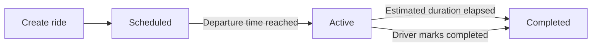

# RaahiX Driver & Car Owner Manual

Practical guide for drivers and car owners using the RaahiX dashboard.

## 1. Sign in

1. Open the RaahiX site and choose **Log in**.
2. Enter your email or username and password.
3. After login you land on **Dashboard** (`/driver`).
4. New drivers: complete **Profile** (licence, UPI, at least one vehicle) and wait for admin verification before creating rides.

## 2. Five dashboard tabs

| Tab | Purpose |
|-----|---------|
| **Dashboard** | Today’s report, quick actions, earnings overview |
| **My Rides** | Create and manage scheduled / active / completed rides |
| **Passengers** | Add walk-in guests, view fare/payment per passenger |
| **Payments** | Payment proofs, refunds, UPI details |
| **Profile** | Account details, vehicles & routes (via links) |

There is no separate Trips tab — schedule buckets live inside **My Rides**.

## 3. Three ride statuses

RaahiX uses exactly three ride statuses:

1. **Scheduled** — created for a future departure; bookable by passengers.
2. **Active** — journey in progress (auto at departure time, or manual if needed).
3. **Completed** — journey finished (auto after estimated duration, or **Mark completed**).

Exceptional cancellations use a **void** flag (not a fourth status). Voided rides cancel related bookings when applicable.

### Automatic lifecycle

**Example:** Departure today 10:00 PM, estimated duration 6 hours → expected completion 4:00 AM next day. At 10:00 PM the ride becomes **Active**. At 4:00 AM it becomes **Completed** if you have not already marked it completed.

The server runs a background job about every 30 seconds. You do not need to keep the browser open.

## 4. Locations (source & destination)

Locations are stored in the database — not hardcoded in the app.

1. Prefer an existing **route** (origin → destination) when scheduling.
2. Drivers/admins can **add locations** via `POST /api/locations` (name, city, state). Duplicate spellings (e.g. “Noida” / “noida”) reuse one record; same name in different states stays distinct.
3. Ride records keep a **name snapshot** so later location edits do not rewrite history.

Manage corridor routes under **Profile → Routes** (`/driver/vehicle-route?section=routes`).

## 5. Create a scheduled ride

1. Open **My Rides → Add ride**.
2. Choose **route** and **vehicle**.
3. Set **departure** and **estimated arrival** (duration is derived for auto-completion).
4. Optional pickup/drop labels and price per seat.
5. Save — status is **Scheduled** immediately (when you are verified).

## 6. Passengers (manual guests)

1. Open **Passengers → Add passenger**, or open a ride → **Passengers**.
2. Enter name (required), phone/email optional, seats, fare, amount collected.
3. Guests do **not** get fake user accounts.
4. Capacity is enforced against the ride’s seats (app bookings + guests).
5. You only see passengers on **your** rides.

## 7. Today’s report

On **Dashboard**, the **Today’s report** block shows:

- Scheduled today (by departure date)
- Active now
- Completed today (by **actual** completion time)
- Passenger counts, expected fare, collected, outstanding, seats

Change the **report date** for historical days without leaving the Dashboard tab.

## 8. Payments & refunds

Use **Payments** for proof review, refunds, and your UPI details.

1. Open a pending screenshot → verify amount and **RAAHIX** payment ID.
2. **Approve** only if the seat hold is still valid — approval permanently books seats.
3. **Reject** with a reason — seats are released for others.
4. Completed rides on **My Rides** show gross fare, collected, outstanding, and net collected.
5. Guest “amount collected” on Passengers is separate from in-app UPI proof payments.

See also `docs/PAYMENT_AND_SEAT_HOLD_WORKFLOW.md` and `docs/DEMO_SEED_DATA_AND_CREDENTIALS.md`.

## 9. Troubleshooting

| Issue | What to try |
|-------|-------------|
| Cannot post rides | Finish profile + wait for VERIFIED |
| Ride still Scheduled after departure | Wait ~30s for the lifecycle job; refresh Dashboard |
| Cannot edit ride | Only **Scheduled** (non-voided) rides are editable |
| Cannot add passenger | Ride may be completed/voided or full |
| Duplicate location? | Normalized matching merges same city/state spellings |

## 10. Privacy

You can only access your own rides, passengers, and payment records. Admin tools are separate.
